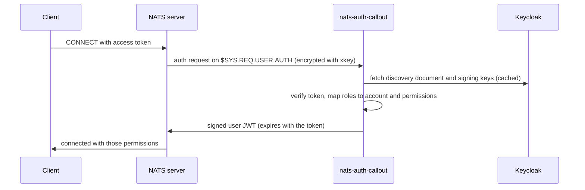

# Deploying nats-auth-callout

nats-auth-callout lets NATS clients log in with OIDC access tokens (tested with Keycloak). NATS
cannot verify OIDC tokens itself, so it asks this service for every connection it cannot authenticate
locally ([auth callout](https://docs.nats.io/running-a-nats-service/configuration/securing_nats/auth_callout)).



Users that are listed in `auth_users` (the callout itself, static users, nkeys, `no_auth_user`, `$SYS`
users) never reach the callout, so you can introduce it next to an existing setup.

## What you need

| | Required | Notes |
|---|---|---|
| NATS server | config mode (auth callout needs 2.10 or newer) | Tested with 2.12.6, 2.14.0 and 2.14.7. No operator/JWT mode needed |
| Two key pairs | issuer (account) key and xkey (curve) | [Step 1](#1-generate-keys) |
| A user for the callout | listed in `auth_users` | [Step 2](#2-configure-nats) |
| OIDC provider | client, audience mapper, roles | [Step 3](#3-configure-keycloak) |
| Permissions file | issuers and role mapping | [Step 4](#4-write-the-permissions-file) |
| The service | container image, Helm chart | [Step 5](#5-deploy-the-callout) |
| Network | callout → NATS (4222), callout → OIDC provider (HTTPS) | NATS never connects to the callout |

Artifacts (image and chart are released independently and have their own version numbers):

- Image: `ghcr.io/pflege-de-labs/nats-auth-callout:<version>`, published for every `v<version>` git tag
  as `X.Y.Z`, `X.Y` and `X`; `:latest` follows the newest stable tag. Builds of `main` and of pull
  request branches are tagged `:main`, `:pr-<number>` and the 7-character commit, e.g. `:abc1234`.
  Multi-arch, signed with cosign; releases also carry SBOM and provenance attestations.
- Chart: `oci://ghcr.io/pflege-de-labs/charts/nats-auth-callout`, published whenever the chart version
  in `Chart.yaml` is raised on `main`; the GitHub releases `nats-auth-callout-<version>` list them. Signed with
  cosign. The chart deploys the image version in its `appVersion` unless you set `image.tag`.

The images and charts are built by the shared workflows in
[pflege-de-labs/github-workflows](https://github.com/pflege-de-labs/github-workflows), so a signature
names that workflow and carries this repository as its workflow repository. Verify both:

```bash
cosign verify \
  --certificate-identity-regexp '^https://github\.com/pflege-de-labs/github-workflows/\.github/workflows/(image-build|image-release|helm-release)\.yml@' \
  --certificate-github-workflow-repository pflege-de-labs/nats-auth-callout \
  --certificate-oidc-issuer https://token.actions.githubusercontent.com \
  ghcr.io/pflege-de-labs/nats-auth-callout:<version>
```

Chart versions released before the switch were signed by this repository's own `chart.yml`
(identity `https://github.com/pflege-de-labs/nats-auth-callout/.github/workflows/chart.yml@refs/heads/main`), and
images before it by `image.yml`; verify those with that identity. The chart version current at the switch may
also gain a second signature from `helm-release`, which does not recognise the old one.

If the packages are private, create a pull secret and set `imagePullSecrets` in the chart values.

## 1. Generate keys

```sh
nsc generate nkey --account   # issuer: prints a seed (SA...) and the public key (A...)
nsc generate nkey --curve     # xkey:   prints a seed (SX...) and the public key (X...)
```

`nk -gen account` and `nk -gen curve` from [nats-io/nkeys](https://github.com/nats-io/nkeys) work as well.
The **seeds** go to the callout (as a Secret), the **public keys** go to the NATS server config.
Pick a password for the callout user too:

```sh
kubectl -n nats create secret generic nats-auth-callout \
  --from-file=issuer-seed=issuer.seed --from-file=xkey-seed=xkey.seed --from-file=password=password.txt
```

> [!WARNING]
> The keys under `.devcontainer/nkey/` are public examples. Never use them outside the devcontainer
> and the tests.

The xkey is optional but recommended: it encrypts the auth request, which contains the user's token.
Without it, any user of the callout account that may subscribe to `$SYS.REQ.USER.AUTH` could read
tokens (in a global-account setup that is every user with a broad subscription).

## 2. Configure NATS

Add an `auth_callout` block and a user for the callout. Every other user that should keep working
**must be listed in `auth_users`**, otherwise it is sent to the callout and rejected:

- the callout user itself (otherwise it cannot connect)
- every static user and nkey (use the public nkey)
- the user behind `no_auth_user`, which anonymous clients (e.g. controllers) are mapped to
- the `$SYS` users, they are sent to the callout like everyone else

Generate the password hash for the NATS config with `nats server passwd`.

### Global account (`$G`)

Token users are placed in `$G` next to your existing users, and see its streams. Quote `$G` in
hand-written `nats.conf` files, an unquoted `$G` is a variable reference.

With the [nats Helm chart](https://github.com/nats-io/k8s/tree/main/helm/charts/nats):

```yaml
config:
  merge:
    # Everything that is not listed in auth_users is sent to the callout.
    authorization:
      users:
        - user: auth-callout
          password: "<bcrypt hash>"
        # ...your existing static users...
      auth_callout:
        issuer: AARWWQ5UIPIIBO5OES5YXQV2HOOUCP6SA7EKKZFDTYICW4U4UETT3XLS
        xkey: XCNO6QXNYUOBP7WSTRTL24BYVF7QGQLSKTH5LFELCUHLUFB2BDVF2CRD
        account: $G
        auth_users:
          - auth-callout
          - sys
    accounts:
      $SYS:
        users:
          - user: sys
            password: "<bcrypt hash>"
```

### Named accounts

Put the callout user in a dedicated account (`AUTH`) and map token users to your accounts with
`account:` in the role mapping:

```yaml
config:
  merge:
    authorization:
      auth_callout:
        issuer: AARWWQ5UIPIIBO5OES5YXQV2HOOUCP6SA7EKKZFDTYICW4U4UETT3XLS
        xkey: XCNO6QXNYUOBP7WSTRTL24BYVF7QGQLSKTH5LFELCUHLUFB2BDVF2CRD
        account: AUTH
        auth_users:
          - auth-callout
          - sys
    accounts:
      # Only holds the callout user; auth requests are published in this account.
      AUTH:
        users:
          - user: auth-callout
            password: "<bcrypt hash>"
      # Target account of the role mapping (role.account: APP).
      APP: {}
      $SYS:
        users:
          - user: sys
            password: "<bcrypt hash>"
```

Roll out the NATS servers after changing the block. A complete, tested example of both setups is in
[`.devcontainer/nats/nats.conf`](../.devcontainer/nats/nats.conf) and
[`e2e/testdata/nats-accounts.conf`](../e2e/testdata/nats-accounts.conf).

## 3. Configure Keycloak

The callout accepts an access token if

1. it is signed by a trusted issuer and not expired,
2. its audience (`aud`) contains the issuer's `audience` value, and
3. it carries at least one role that is mapped in the permissions file.

In Keycloak that means, per realm:

- **A client for NATS users.** For people and apps use a public client with PKCE (and the device flow
  for CLIs); for services use a confidential client with *Service accounts roles* enabled.
- **An audience mapper** on every client whose tokens are used for NATS: *Clients → `<client>` → Client scopes →
  `<client>-dedicated` → Add mapper → By configuration → Audience*, *Included Client Audience* = the
  `audience` value, *Add to access token* on. The token's `aud` must contain that value; an explicit
  mapper makes this independent of which roles the user holds.
- **Client roles** on the client named in `roleClient` (for example `events-read`), assigned to users or
  service accounts. They appear under `resource_access.<client>.roles` in the token, so *Full scope
  allowed* must be on or the roles must be in the client's scope. Realm roles work too.

[`.devcontainer/keycloak/realm-test.json`](../.devcontainer/keycloak/realm-test.json) is a complete
realm import with all of this.

The token's `iss` claim has to equal the issuer `url` in the permissions file character for
character; it depends on how Keycloak's hostname is configured.

## 4. Write the permissions file

```yaml
issuers:
  - url: https://keycloak.example.com/realms/myrealm   # must equal the "iss" claim
    audience: nats                                     # must be in the "aud" claim
    roleClient: nats                                   # client whose roles are mapped; realm roles always are
    # discoveryURL: http://keycloak.keycloak.svc/realms/myrealm  # optional: where to fetch the discovery document

defaultAccount: $G      # account for roles without account (default: $G)

roles:
  events-read:
    sub:
      allow: ["events.>", "_INBOX.>"]
    pub:
      allow: ["$JS.API.INFO", "$JS.API.STREAM.INFO.EVENTS"]
  orders-publish:
    pub:
      allow: ["orders.>"]
  admin:
    account: ADMIN       # place users with this role in another account
    pub:
      allow: [">"]
```

How tokens are mapped:

- Roles that are not in `roles` are ignored. A token without any mapped role is rejected.
- The permissions of all mapped roles are merged. All mapped roles must resolve to the same account,
  otherwise the login is rejected.
- Permission fields per role: `pub` and `sub` (each with `allow` and `deny` subject lists) and `resp`
  (`maxMsgs`, `ttl`) to allow replies to requests. Nothing is allowed that is not listed.
- The user JWT expires together with the access token.
- Multiple issuers (for example one per realm) can be listed. The right one is selected by the token's `iss`.

Plan the subjects your clients really need. JetStream clients, for example, need the `$JS.API.*`
subjects of the operations they use. MQTT clients (see below) need both `topic` and `topic.>` for a
subscription to `topic/#`. [`e2e/testdata/permissions-accounts.yaml`](../e2e/testdata/permissions-accounts.yaml)
has tested examples for a read-only JetStream consumer and MQTT.

`discoveryURL` is for callouts that reach Keycloak by another address than the public one. The signing
keys are fetched from the `jwks_uri` in the discovery document, so that address must be reachable from the
callout too.

## 5. Deploy the callout

### Helm

```sh
helm install nats-auth-callout oci://ghcr.io/pflege-de-labs/charts/nats-auth-callout \
  --namespace nats --version <chart version> -f values.yaml
```

```yaml
# values.yaml
nats:
  url: nats://nats.nats.svc:4222
  authUser: auth-callout
secret:
  existingSecret: nats-auth-callout   # keys: issuer-seed, xkey-seed, password
permissions:                          # the permissions file from step 4
  issuers:
    - url: https://keycloak.example.com/realms/myrealm
      audience: nats
      roleClient: nats
  roles:
    events-read:
      sub:
        allow: ["events.>"]
serviceMonitor:
  enabled: true
```

The chart runs 2 replicas, spread across nodes, with probes and a PodDisruptionBudget. All values are
documented in the [chart README](../charts/nats-auth-callout/README.md). Set `xkey.enabled: false` if
the server has no `xkey`.

### Container

Without Helm, run the image with these settings (flags or environment variables; a YAML file can be
passed with `--config`):

| Flag | Environment | |
|---|---|---|
| `--nats-url` | `NATS_URL` | NATS server |
| `--auth-user`, `--auth-password[-file]` | `AUTH_USER`, `AUTH_PASSWORD[_FILE]` | the callout user |
| `--issuer-seed[-file]` | `ISSUER_NKEY[_FILE]` | issuer seed |
| `--xkey-seed[-file]` | `XKEY[_FILE]` | xkey seed |
| `--permissions-file` | `PERMISSIONS_FILE` | permissions file from step 4 |
| `--listen` | `LISTEN` | address for probes and metrics (`:8088`) |
| `--debug` | `DEBUG` | log allowed connections too |

Prefer the `*_FILE` variants with mounted secrets over plain environment variables.

## 6. Verify

```sh
kubectl -n nats get pods -l app.kubernetes.io/name=nats-auth-callout      # READY 1/1 once NATS and Keycloak are reachable

TOKEN=$(curl -s -d grant_type=client_credentials -d client_id=<client> -d client_secret=<secret> \
  https://keycloak.example.com/realms/myrealm/protocol/openid-connect/token | jq -r .access_token)

nats --server nats://nats.nats.svc:4222 --token "$TOKEN" pub events.test hello   # allowed by the role mapping
nats --server nats://nats.nats.svc:4222 --token "$TOKEN" pub forbidden.test hi   # permissions violation
```

Existing users keep working: connect as before and with no credentials, and check that
`nats server report connections` shows token users in the account you expect.

## Using it from clients

Clients send the access token as the NATS connect **token**:

```go
// Fetch a fresh token for every (re)connect: the connection ends when the token expires.
nc, err := nats.Connect(url,
    nats.TokenHandler(func() string { return currentAccessToken() }),
    nats.MaxReconnects(-1))
```

```sh
nats --server nats://nats.example.com:4222 --token "$TOKEN" sub 'events.>'
```

- **Token expiry.** NATS closes the connection when the access token expires. A client with a static
  `nats.Token(...)` is disconnected for good, a client with a token handler reconnects with a new token.
  Keep the access token lifespan in Keycloak in mind (default 5 minutes).
- **MQTT.** The token is the MQTT *password*; use any username that is not listed in `auth_users`.
- **Browsers.** Enable the NATS `websocket` listener and send the token in the connect options as
  well. Terminate TLS in front of NATS, tokens are sent in clear text otherwise.
- **TLS.** Use TLS between clients and NATS in production for the same reason.

All three paths (token over TCP, MQTT, websocket, expiry and reconnect) are covered by the
[e2e tests](../e2e).

## Migrating an existing cluster

1. Deploy the callout and verify it with a test user (steps 1 to 6) before NATS knows about it.
2. Add the callout user and `auth_callout` to NATS with **all** existing users in `auth_users`. Existing
   clients are unaffected, they never reach the callout.
3. Move clients to tokens one by one. When a static user is no longer used, remove it from its
   definition and from `auth_users`.
4. Optionally remove `no_auth_user` once no anonymous client is left.

## Operations

**Availability.** Run at least 2 replicas; requests are distributed over a NATS queue group. If no
callout is running, token logins fail after about 2 seconds (the client sees an `i/o timeout`).
Users in `auth_users` and `no_auth_user` are not affected, and neither are connections that are already
open.

**Probes.** `/healthz` is always `200` while the process runs. `/readyz` is `200` once the service is connected to
NATS and has loaded the discovery document of every issuer, otherwise `503` with the reason.

**Metrics** (Prometheus format on `/metrics`, OpenTelemetry instruments):

| Metric | |
|---|---|
| `auth_callout_requests_total{result}` | `allowed`, `denied` or `error` |
| `auth_callout_duration_seconds` | histogram of the time to answer a request |

**Logs** are JSON. Denied connections are logged at `info` with the reason in `error`; clients only see
`Authorization Violation`. Use `--debug` to log allowed connections as well.

**Rotating keys.** The issuer key and xkey exist on both sides (public in NATS, seed in the callout).
Change both at the same time: update the Secret and the NATS config, then roll both. New token logins
fail between the two changes, so choose a quiet moment.

**Security notes.** Keep the seeds in a secret store. Give the callout user only the access it needs,
and keep it in its own account if you use named accounts. Run NATS with TLS. The callout does not log or store
tokens.

## Troubleshooting

| Symptom | Cause |
|---|---|
| Client: `Authorization Violation` | The callout denied the login. Find `connection denied` in its logs, the `error` field has the reason |
| Client: `i/o timeout` while connecting with a token | No callout answers: not running, not connected, or the callout user is not in `auth_users` |
| Log: `no token in connect options` | The client sent no token and its user is not in `auth_users`. This is how an existing user that was forgotten in `auth_users` shows up |
| Log: `untrusted issuer "..."` | The token's `iss` does not equal any `issuers[].url` |
| Log: `verify token: ...` | Signature, expiry or audience problem; check the audience mapper in Keycloak |
| Log: `no NATS role assigned` | The token has no role that is in `roles`; check `roleClient`, role assignment and *Full scope allowed* |
| Log: `roles [...] target different accounts` | Roles of one user map to different accounts |
| Log: `discover issuer ...` / `/readyz` shows `oidc:` | The callout cannot reach the discovery document or `jwks_uri` |
| Log: `server encrypts auth requests but no xkey is configured` | `auth_callout.xkey` is set in NATS but the callout has no xkey (chart: `xkey.enabled`) |
| Log: `decrypt auth request` | The xkey seed does not belong to `auth_callout.xkey` |
| NATS log: `Authorization callout account "..." not valid` | `auth_callout.account` does not exist in the NATS config |
| `/readyz` shows `nats: not connected` | Wrong `nats.url`, or the callout user or password is wrong |
